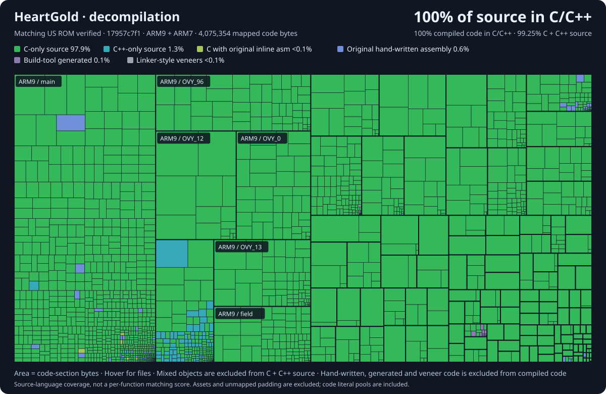

# Pokémon HeartGold and SoulSilver

**Not affiliated with pret.**

This is a fork of pret's pokeheartgold repo, and the original tooling is all theirs. pret doesn't accept AI-generated code and doesn't want to be associated with this, so don't send anything from here upstream or bother them about it; keep everything here.

Fully decompiled: everything's C/C++ and both ROMs build byte-for-byte. Built with LLM agents.

Setup is in [INSTALL.md](INSTALL.md).

## iOS landscape development

The `dev-JasonCen` branch adds a native Swift/Metal iOS game slice with a landscape single-screen interface, original New Bark Town / Route 29 assets, touch controls, basic battles and independent saves. Battles reuse original HGSS backgrounds, platforms, health boxes and menu art with a native two-level command/move panel. The iOS target has no DS emulator dependency and does not load ROMs. The full game port is still in progress. See [ios/README.md](ios/README.md) for builds, verification and current limits.

This repository builds the following ROMs:

* **pokeheartgold.us.nds** `sha1: 4fcded0e2713dc03929845de631d0932ea2b5a37`
* **pokesoulsilver.us.nds** `sha1: f8dc38ea20c17541a43b58c5e6d18c1732c7e582`
