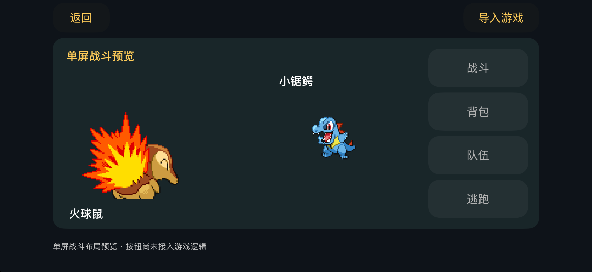

# HeartGold / SoulSilver iOS 横屏适配

## 当前状态

这是第一阶段的 iOS 运行宿主与原版素材预览，**不是已经完成的单屏游戏移植**。



- 上游基线：`ctrl-cheeb-del/pokeheartgold` 的 `master`，提交 `8ad0259e0b10ba65edc8f903c810c2452bf84871`。
- 开发分支：`dev-JasonCen`。
- iPhone / iPad 仅横屏，UIKit 与 Objective-C++ 原生宿主。
- 原版御三家 PNG 由构建过程从 `../files/` 直接引用，不重新绘制、不复制维护另一份资源。
- “查看单屏布局”展示原版正面/背面精灵与原生指令区的横屏排版。它明确标为布局预览，未绑定的战斗按钮禁用；不执行虚构的战斗逻辑。
- melonDS 作为固定提交的子模块，关闭 JIT、OpenGL 和桌面前端，使用解释器、软件渲染、FreeBIOS 和生成的固件。
- 构建脚本会应用 `patches/melonDS-initial-renderer.patch`：首次安装渲染器时跳过尚未初始化的 VRAM 捕获同步。检查程序用预填充内存构造核心，防止初始化崩溃回归。这个小补丁会使子模块显示本地修改，不改变其固定提交。
- 已实现 `.nds` 导入校验、按文件 SHA-256 隔离存档、游戏按键、音频队列、前后台暂停和原子存档写入。
- 主循环采用与 melonDS 相同的约 59.8261 Hz 节奏，恢复时重新定时；游戏 RTC 从设备日历初始化。真机的速度、音频漂移和功耗还需要实际游戏测试。
- 游戏运行路径是 **编译后的 DS 游戏 → melonDS → iOS 宿主**；当前没有把上游 `src/` 编译成原生 iOS 游戏逻辑。
- 运行验证模式中的“触摸菜单”仍然是下屏图像合成到主画面的临时覆盖层。它仅用于验证输入与显示，**尚未达到逐场景重新设计单屏界面的目标**。

本机没有游戏 ROM、原版编译器和 SDK，因此尚未验证原作地图、战斗、读档或完整流程。应用内的素材预览不会伪装成可玩的原作。

## 本地构建

需要 macOS、Xcode 和 CMake 3.20 或更新版本。不需要安装额外 iOS UI 框架。

```sh
git submodule update --init --recursive
./ios/build.sh check
./ios/build.sh
open ios/build/HeartGoldIOS.xcodeproj
```

`check` 在 macOS 上编译同一个核心与平台适配器，运行一个 assert 检查程序。覆盖 ROM 长度/段边界、横屏坐标、音频缓冲、存档更新与写入失败、文件/线程接口，以及 FreeBIOS 下的实际核心帧。它还在内存中生成一个仅写入标记的原创 ARM9 小程序，经过 ROM 加载与解释执行后检查结果，不使用商业游戏 ROM。**这些检查不等于原作游戏兼容性测试。**

模拟器产物位于 `ios/build/Release-iphonesimulator/HeartGoldIOS.app`。可通过 `CMAKE_BIN=/absolute/path/to/cmake` 指定 CMake。此开发环境使用的 CMake 位于工作区 `work/build-tools/bin/cmake`，它不是仓库依赖，也没有提交到 Git。

真机需要另外生成 iPhoneOS 工程并在 Xcode 中配置自己的开发团队：

```sh
cmake -S ios -B ios/build-device -G Xcode \
  -DCMAKE_SYSTEM_NAME=iOS -DCMAKE_OSX_SYSROOT=iphoneos \
  -DCMAKE_OSX_DEPLOYMENT_TARGET=16.0
open ios/build-device/HeartGoldIOS.xcodeproj
```

## 运行游戏所需材料

导入完整的美版 HeartGold (`IPKE`) 或 SoulSilver (`IPGE`) `.nds` 文件。文件由系统文件选择器读取，应用不修改原文件，也不自动下载游戏。

如从本仓库构建游戏，上游 `scripts/setup-macos.sh` 要求通过 `POKEHEARTGOLD_TOOLCHAIN_DIR` 提供 `mwccarm.zip` 与 `NitroSDK-3_2-060901.7z`。这些工具不包含在 Git 仓库中。本 iOS 宿主可以独立编译，但缺少它们时还不能用当前环境重建游戏 ROM。

普通游戏存档位于 App 的 Application Support/HeartGold 目录，名称为 `<ROM的SHA256>.sav`。当前每秒合并写入一次，暂停或进入后台时再次提交。写入先落到 `.tmp`，成功刷新后才原子替换目标；失败会保留原存档和内存中的新进度，并在界面报告。

## 下一阶段的验收条件

1. 取得可运行的游戏构建，验证开场、进入地图、走动、触发一场战斗、游戏内存档和重启读档。
2. 从原作场景状态接出稳定的数据接口，把地图菜单、战斗指令、背包和队伍改为单屏原生布局，移除临时下屏覆盖层。
3. 扩展到其余应用场景，逐一验证触摸坐标、场景切换、存档兼容和资源动画。
4. 验证真机性能、音频时钟、长时间运行、最大文字尺寸与 VoiceOver。解释器和软件渲染的真机性能尚未测量。

本阶段不支持联机、DSi、麦克风和外设功能。相关平台回调只提供离线返回值。

## 本次验证（2026-10-17）

- Xcode 27.0 的 Release 模拟器构建成功。
- `./ios/build.sh check`：1/1 通过，包含预填充内存的初始化回归检查与原创 ARM9 程序执行检查。
- iOS 26.5 / 27.0 模拟器均已启动并显示原版素材预览。
- iOS 27.0 已实际检查“查看单屏布局”、返回、未接入按钮的禁用语义，以及系统文件选择器的打开和取消返回。
- 已检查预览截图、PNG 去底、像素缩放、plist 格式、构建脚本语法与 Git 空白错误。
- 未验证：原作完整流程、真机性能和签名、实际游戏存档读写、最大字号/VoiceOver 的完整验收。存档的原子写入与失败保护只通过宿主检查程序验证。

## 来源

- 游戏源码、数据与素材来自本仓库保留的上游工程；原作者说明和文件没有删除。
- [melonDS](https://github.com/melonDS-emu/melonDS)，固定在 `906e9ebb27da8c6a715cd7abab4abfe8a8d29427`，许可证见 `Vendor/melonDS/LICENSE`。
- `ios/App/` 和 `ios/tests/` 的新增宿主代码按 GPL-3.0-or-later 提供；这不改变原版游戏素材和上游各文件的权利归属。
