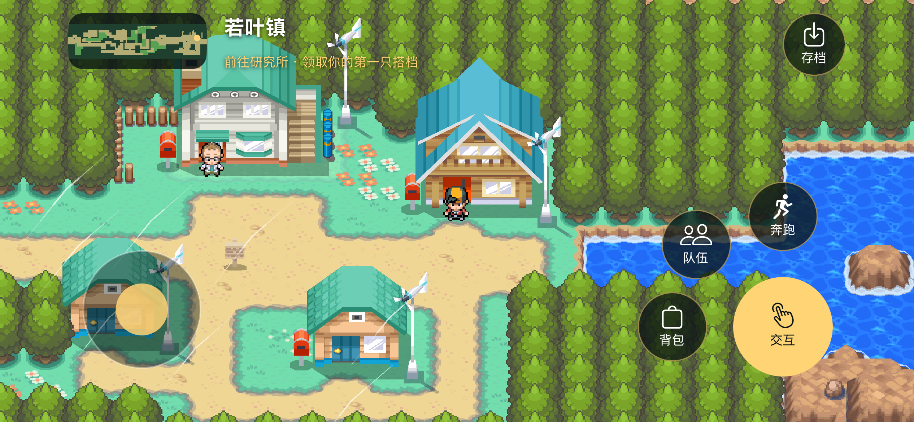
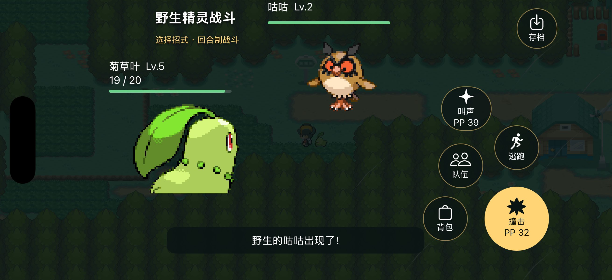

# HeartGold Native · iOS 横屏单屏移植

当前分支的 iOS 目标已切换到 **Swift 游戏逻辑 + Metal 地图渲染 + UIKit 触摸界面**。启动直接进入原生场景，App 不加载 ROM。melonDS 子模块、DS 宿主适配层和对应构建目标已移除。

这是首个可玩移植切片，**完整《心金》的剧情与系统尚未移植完成**。原作源码保留在上级目录，作为后续移植依据。




## 当前可玩内容

- 原版若叶镇、29 号道路的地形和建筑，以原生 Metal 三角网格渲染；跟随镜头铺满横屏。
- 原版碰撞标记、水面阻挡、草丛遇敌；根据设备时间选择原版晨间／白天／夜间遇敌表。
- 研究所门前领取御三家，搭档跟随，家门口交互恢复 HP 与 PP。
- 七种精灵：菊草叶、火球鼠、小锯鳄、波波、小拉达、尾立、咕咕。
- 基础回合战斗：速度与招式优先级、命中、伤害浮动、要害、当前物种所需的属性相性、攻击／防御等级、PP、挣扎、经验与升级。
- 伤药、精灵球捕获、最多六只的队伍、主动换人、倒下后换人、逃跑和战败返家。
- 独立的 JSON 存档：位置、队伍、道具、随机数状态及整个当前战斗；手动保存、每 15 秒自动保存、退到后台保存。写入采用 Foundation 原子替换，坏存档会保留并阻止覆盖。

操作借鉴横屏手游的拇指分区：左下摇杆，右下主交互／招式键，周围放置背包、队伍、奔跑／逃跑与其余招式，左上小地图，右上存档。宝可梦仍按回合制结算。

应用名为「心金 · 原生」，Bundle ID 为 `com.jasoncen.heartgold.native`。新存档位于 App 的 `Application Support/HeartGoldNative/save-v1.json`，与旧版 DS 宿主的 `.sav` 分开。当前不导入原作 DS 存档。

## 构建与检查

需要 macOS 和 Xcode；生成 iOS 工程还需要 CMake 3.20+。普通构建使用已提交的转换资源，不需要 ROM、NitroSDK、mwccarm、Rust 或 Python 图像库。

```sh
./ios/build.sh check
./ios/build.sh
open ios/build-native/HeartGoldNative.xcodeproj
```

可通过 `CMAKE_BIN=/absolute/path/to/cmake` 指定 CMake。本工作区使用 `work/build-tools/bin/cmake`。

开发模拟器产物：
`ios/build-native/Release-iphonesimulator/HeartGoldNative.app`。

生成 iPhone 真机工程：

```sh
cmake -S ios -B ios/build-native-device -G Xcode \
  -DCMAKE_SYSTEM_NAME=iOS -DCMAKE_OSX_SYSROOT=iphoneos \
  -DCMAKE_OSX_DEPLOYMENT_TARGET=16.0
cmake --build ios/build-native-device --config Release \
  --target HeartGoldNative -- CODE_SIGNING_ALLOWED=NO -quiet
open ios/build-native-device/HeartGoldNative.xcodeproj
```

安装到真机还需要在 Xcode 中设置自己的开发团队与签名。未签名的构建成功不代表已经通过真机测试。

`check` 直接用 macOS Swift 编译同一份 `App/Game.swift`，不链接图形界面。一个 assert 检查覆盖原版碰撞表中的实际路径、领取搭档、遇敌、战斗胜利、升级学习、捕获、换人、挣扎同时倒下、战斗中保存与确定性读回、坏存档和写入失败保护。

## 数据与素材来源

素材按当前要求沿用原版，转换不会重新绘制美术。地图模型和贴图在离线阶段转成普通顶点缓冲与 PNG，原生 App 只读取这些数据。

| 原作来源 | 原生用途 |
| --- | --- |
| `files/fielddata/mapmatrix/map_matrix/map_matrix_0000_EVERYWHERE.bin`、`files/a/0/6/5` | 地图块、建筑位置、原版碰撞和草丛标记 |
| `files/a/0/4/0`、`files/a/0/4/4`、`files/a/0/7/0` | 建筑网格、地形与建筑贴图 |
| `files/data/mmodel/mmodel/` | 主角、博士和跟随精灵 |
| `files/poketool/pokegra/pokegra/` | 战斗正／背面精灵，按原构建规则使用正面文件的普通配色 |
| `files/poketool/personal/personal.json`、`wotbl.narc`、`files/poketool/waza/waza_tbl.narc` | 种族值、升级招式、招式数据 |
| `files/fielddata/encountdata/gs_enc_data.json` | 心金 29 号道路遇敌表 |

移植规则参考 `src/pokemon.c` 的能力值公式、`src/battle/battle_util.c` 的伤害处理、`src/field_terrain.c` 的地形属性，以及 `src/field/map_load_manager.c` 与 `map_prop_manager.c` 的地图加载与模型位置。代码在 Swift 中重新实现了当前覆盖的部分；没有把整个原作 C 引擎重新编译成 iOS。

离线转换工具为 [apicula](https://github.com/scurest/apicula)，本次固定提交 `3d4e91e14045392a49c89e86dab8cb936225588c`，0BSD 许可。它只用于开发时读取 Nitro 资源，未链接或打包进 App。导出脚本使用 Python 3 和已安装的 Pillow。

```sh
python3 ios/tools/export_assets.py \
  --work /absolute/path/to/work/native-assets \
  --apicula /absolute/path/to/apicula
```

`Resources/sources.json` 记录输入源码资源的 SHA-256。跟随精灵临时转换副本仅选择普通色板；原始文件不变。导出阶段同时检查 NARC 边界、三角网格、材质资源与地图数据完整性。

界面实现使用 Apple [MetalKit](https://developer.apple.com/documentation/metalkit) 与 UIKit；操作布局的参考是 [Wild Rift](https://wildrift.leagueoflegends.com/en-gb/game-overview/) 的横屏手游分区习惯，未引入它的素材或玩法。

## 当前边界与后续移植

- 事件是最小验证流程：家门口 → 研究所外领取 → 西侧草丛。室内、原作开场与完整脚本、其余地图尚未接入。
- 当前成长上限为 Lv.10；使用随机 IV、中性性格和零 EV。后续需接入完整性格／EV、特性、携带物、异常状态、进化及全部招式效果。未覆盖的招式效果不会被伪装成已实现。
- 碰撞当前处理原版阻挡标记与水面；还需移植单向台阶、跳跃、桥梁与各类地形事件。
- 地形高度由原版地形三角网格采样，未移植整套 BDHC 查询。原版材质动画尚未接入，部分贴图矩阵需要进一步还原。
- 音乐、原版音效、商店／经济、图鉴、PC、多人与其余外设功能尚未移植。
- 尚需真机多点触摸、帧率、功耗、长时间运行、最大字号和完整 VoiceOver 验收。

## 验证记录（2026-10-17）

- Swift 逻辑检查通过；不使用商业 ROM或 DS 运行核心。
- Xcode 27 的原生 iOS Release 构建通过；另已生成未签名的 iPhoneOS arm64 真机产物。
- iPhone 17 Pro／iOS 26.5 开发模拟器中，已手动验证摇杆长按移动、松手停止、辅助功能方向操作、镜头跟随、领取菊草叶及跟随、原生遇敌与招式／HP／PP／道具结算、战斗胜利。
- iPhone 17e／iOS 27.0 中已冷启动并检查横屏地图、模型、原版角色配色和控制区布局。
- 原生战斗中保存后重启 App，恢复了菊草叶 19/20 HP、叫声 PP39、敌方攻击下降一级及同一只咕咕；随后继续完成战斗。
- 损坏存档与文件写入失败保护在逻辑检查中验证；未在真机上模拟存储故障。
